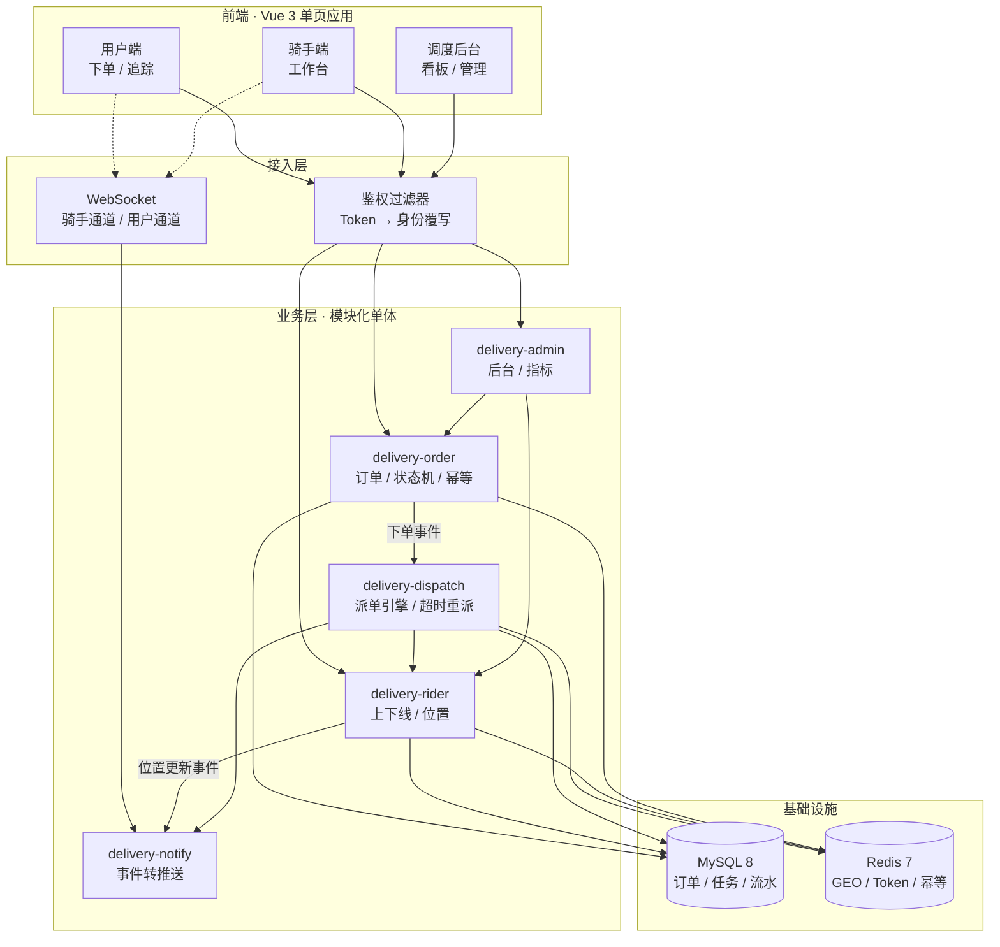

<div align="center">

# SwiftDrop

**同城即时配送调度平台 · 订单 → 派单 → 履约 → 追踪 全链路闭环**

一条完整的同城即时配送链路：用户下单 → 调度引擎按五因子加权实时派单 → 骑手接单配送 → 用户在地图上实时看到订单状态与骑手位置。

[](https://github.com/MANYINUO/SwiftDrop/stargazers)
[](https://github.com/MANYINUO/SwiftDrop/network/members)
[](https://github.com/MANYINUO/SwiftDrop/commits/main)
[](https://github.com/MANYINUO/SwiftDrop/issues)

[](https://openjdk.org/)
[](https://spring.io/projects/spring-boot)
[](https://www.mysql.com/)
[](https://redis.io/)
[](https://vuejs.org/)
[](https://developer.mozilla.org/docs/Web/API/WebSocket)

**[功能特性](#-功能特性) · [核心设计](#-核心设计) · [快速开始](#-快速开始) · [接口概览](#-接口概览) · [项目结构](#-项目结构)**

</div>

---

## ⚡ 项目概述

SwiftDrop 是一个**前后端分离的同城即时配送调度系统**。它不只是增删改查——项目的重心在**调度引擎**：在有容量、距离合适的骑手中，综合距离、负载、顺路程度、评分与时效风险进行加权打分，把每一笔订单实时匹配给最合适的骑手，并处理拒单、超时、并发抢单这些真实场景。

> **SwiftDrop** = Swift（快）+ Drop（送达）。名字取自即时配送的本质：订单从下达到交付的每一秒都在计价，系统要做的是在「最快」和「最合适」之间找到平衡。

三套界面，一套后端：

- **用户端**：匿名下单、地图选点、订单追踪（实时骑手位置与轨迹）
- **骑手端**：派单推送、接单 / 拒单 / 取货 / 送达、位置持续上报
- **调度后台**：指标看板、订单管理、骑手管理、人工干预、**每一轮每位候选骑手的打分明细**

### 🚀 六大优势

1. **派单不是轮询也不是随机**：五因子加权打分，每一次派单、每个候选的得分与因子明细全部落库，可在后台逐单复盘。
2. **并发安全不靠堆锁**：接单是四步原子事务，任何一步影响行数为 0 即整体回滚；状态流转用条件更新（CAS）拦截并发，两个骑手同时抢单恰好一人成功。
3. **实时推送与业务解耦**：订单与骑手模块只发布领域事件，通知模块统一监听并推送。业务模块不需要感知 WebSocket 的存在。
4. **高频写入不冲击数据库**：位置上报走「Redis 同步 + 内存队列异步批量落库」的读写分离，上报接口不被落库拖慢。
5. **身份不可伪造**：统一鉴权过滤器用 Token 中的真实身份**覆写**内部身份请求头，前端伪造的身份头一律无效，防水平越权。
6. **全链路可观测**：派单打分明细、订单事件流水、骑手位置轨迹，三层数据都落库，出问题能一路查到底。

### 🏗️ 技术全景

<div align="center">



</div>

---

## ✨ 功能特性

### 用户端

- 匿名访问，首页一键领取游客身份即可下单，**无需注册**
- 在高德地图上点选取件 / 送达位置，自动回填经纬度并预估配送距离与费用
- 我的订单、按状态筛选、取消订单
- 订单追踪：地图实时展示骑手位置与移动轨迹、状态步骤条、订单动态时间线（WebSocket 推送）

### 骑手端

- 骑手编号 + 校验码登录、上线 / 下线（上线带定位）
- 派单实时推送，展示取送地址、距离、金额与响应倒计时
- 接单 / 拒单、取货、送达，进行中订单在刷新页面后可恢复
- 位置持续上报，内置「模拟移动」便于演示整条配送轨迹
- 接单容量约束：在手订单达到上限后不再被派单

### 调度后台

- 管理员账号登录
- 指标看板：订单量、派单成功率、平均接单响应 / 配送时长、状态分布、在线骑手（ECharts，定时刷新）
- 订单管理：状态、路线、骑手、派单轮次，以及**每一轮、每位候选骑手的打分明细**与事件流水
- 骑手管理：在线 / 工作状态、负载、评分、实时位置
- 人工干预：手动派单 / 按算法重派、标记异常、异常后改派或取消

---

## 🏗️ 系统架构

### 模块划分

后端采用 **Maven 多模块的模块化单体**。没有拆微服务，是因为这个规模下拆了只会增加分布式事务和运维成本；但模块边界严格，依赖方向单向，将来要拆随时能拆。

```
swiftdrop/                       父 POM（packaging=pom），聚合模块并统一依赖版本
├── delivery-common/             统一响应、错误码、业务异常、状态枚举、Redis GEO 仓库、
│                                Token 与鉴权过滤器、CORS、配置与工具类
├── delivery-rider/              骑手：上下线、位置上报、附近检索、容量
├── delivery-order/              订单：创建、状态机、事件流水、幂等
├── delivery-dispatch/           调度引擎：候选筛选与打分、派单任务、接单原子事务、超时重派
├── delivery-notify/             WebSocket 长连接、领域事件转实时推送
├── delivery-admin/              调度后台：查询、手动派单、异常处理、指标聚合
└── delivery-boot/               启动模块：聚合以上模块、配置文件与可执行 jar
```

模块依赖方向（**不允许反向依赖**）：

```
boot → admin / notify → dispatch → order / rider → common
                        notify  → order / rider
                        order   → rider
```

订单与骑手模块只**发布领域事件**，通知模块负责**监听并推送**。因此业务模块不需要感知 WebSocket 的存在，调度逻辑与实时通信彻底解耦。

### 一次完整派单流程

| 步骤 | 阶段 | 主要操作 | 参与模块 | 关键点 |
|---|---|---|---|---|
| 1 | 下单 | 地图选点提交订单，携带 `Idempotency-Key` | order | 幂等键占位，并发重复提交只产生一笔订单 |
| 2 | 落库 | 订单入库，状态置为「待派单」，写事件流水 | order | 状态机合法性校验 + 发布下单事件 |
| 3 | 触发 | 监听下单事件，启动派单 | dispatch | 派单在**事务提交后**才发起 |
| 4 | 召回 | Redis GEO 阶梯半径检索在线且有余量的骑手 | dispatch + rider | 半径 1km → 3km → 5km，最多 3 轮 |
| 5 | 打分 | 五因子加权，取候选前 N 名 | dispatch | 每个候选的因子明细写入 `score_detail` |
| 6 | 推送 | WebSocket 下发派单任务，带响应倒计时 | notify | 骑手通道 `/ws/rider/{riderId}` |
| 7 | 响应 | 骑手接单 / 拒单 / 超时未响应 | dispatch | 接单为四步原子事务，拒单永久排除，超时降权 |
| 8 | 履约 | 取货 → 配送中 → 已送达 | order | 每次流转走条件更新（CAS） |
| 9 | 跟踪 | 位置上报与状态变更实时推送 | rider + notify | 位置推送按「订单 + 骑手」3 秒节流 |
| 10 | 兜底 | 候选耗尽置为「需人工调度」 | admin | 后台手动派单 / 改派 / 取消 |

> 第 4~7 步构成**一轮派单**。一轮失败就进入下一轮，扩大半径、排除已拒单的骑手，直到有人接单或候选耗尽。

### 前端结构

```
frontend/
├── src/api/          Axios 实例（统一携带 Token、处理 401/403、解包 { code, message, data }）与各端接口
├── src/utils/        amap（高德 SDK 单例加载）、ws（断线重连）、geo（距离 / 坐标投影）、format、auth
├── src/components/   MiniMap（高德地图：选点 / 标记 / 路线 / 轨迹）、RouteLine、StatusSteps、StatusPill
└── src/views/
    ├── auth/         管理员登录、骑手登录
    ├── user/         下单（地图选点）、我的订单、订单追踪
    ├── rider/        骑手工作台
    └── admin/        指标看板、订单管理、骑手管理
```

---

## 🧠 核心设计

项目的技术含量集中在这一章。每一节都是**踩过坑之后改出来的**，不是一开始就这么设计的。

### 1. 订单状态机：两层防护

```
待派单 → 派单中 → 待取货 → 配送中 → 已送达
  ↘        ↙（拒单 / 超时重派）
  已取消 / 异常（异常可回到待派单重新改派）
```

- **第一层 · 合法性校验**：内存中的状态转移表，拦截「已送达又改回配送中」等非法流转。
- **第二层 · 乐观锁落库**：通过条件更新拦截并发，只有当前状态匹配时更新才生效：

```sql
UPDATE delivery_order SET status = ?, version = version + 1
WHERE id = ? AND status = ? AND version = ?
```

合法性校验挡不住并发，条件更新（CAS）才是并发安全的关键。另有两条铁律：除「派单失败回到待派单」外状态只前进不后退；配送中不允许直接取消（骑手已在路上），只能走异常处理或等待送达。

### 2. 派单算法：Redis GEO 检索 + 五因子加权打分

先用 Redis GEO 在阶梯半径内检索在线且有剩余容量的骑手，再对候选批量打分：

```
score = 0.35×距离分 + 0.20×负载分 + 0.25×顺路分 + 0.10×评分分 + 0.10×时效风险分
```

| 因子 | 权重 | 计算方式 |
|---|---|---|
| 距离分 | 35% | `1 - min(骑手到取件点距离 / 搜索半径, 1)` |
| 负载分 | 20% | `1 - 在手单数 / 最大承载` |
| 顺路分 | 25% | 基于骑手**行进方向**与「骑手→取件点」方向的余弦相似度，需要记录上一个位置来推算行进方向 |
| 评分分 | 10% | 历史服务评分 / 5 |
| 时效风险分 | 10% | 按预计送达相对承诺时效的超时风险归一化 |

搜索半径按轮次阶梯扩大（**1km → 3km → 5km**），每轮推送候选数有上限，最多 3 轮；候选耗尽则置为「需人工调度」，由后台介入。每一次派单、每个候选的得分与各因子明细都会落库（`dispatch_task.score_detail`），可在后台直接复盘。

> 顺路分是最容易做假的一个因子。很多实现直接用「骑手到取件点距离」代替顺路，那就退化成距离分了。真正要算的是**方向夹角**——骑手正往东走，取件点在西边，就算距离近也不该派给他。

### 3. 接单：四步原子事务，防并发超卖

一次接单在单个事务内完成：

1. 条件更新抢占订单（`WHERE status = '派单中'`）
2. 将派单任务由 `PENDING` 改为 `ACCEPTED`
3. 作废同一轮的其他派单任务
4. 骑手容量条件 +1（`delivering_count < max_capacity`）

**任何一步影响行数为 0 即整体回滚**，从而保证两个骑手同时抢单时恰好一人成功、且骑手不会超过接单上限。

### 4. 拒单与超时重派

- **拒单**：在后续轮次中**永久排除**该骑手（尊重骑手意愿）；当轮已无其他待响应任务时立即进入下一轮。
- **超时未响应**：对该骑手**降权**而非永久排除（超时可能只是暂时忙碌），由定时任务扫描过期的 `PENDING` 任务并触发下一轮派单。

> 这两种情况的处理方式不同，是有意为之：拒单是明确表态，超时只是没顾上。混为一谈会让系统在骑手忙的时候把他永久拉黑，越忙越接不到单，形成死循环。

### 5. 位置上报：实时与历史读写分离

```
骑手上报 → ① Redis SETNX 防抖（丢弃短时间内的重复上报）
         → ② 同步写 Redis GEO（调度依赖实时位置）
         → ③ 写入内存缓冲队列（不阻塞上报接口）
         → ④ 发布领域事件，经 WebSocket 推送给下单用户
定时任务 → ⑤ 缓冲队列批量落库为历史轨迹
```

调度需要实时位置，而历史轨迹不需要实时写入；把两条链路分离，避免高频上报直接冲击数据库。

### 6. 下单幂等

创建订单要求携带 `Idempotency-Key`。服务端以幂等键占位并记录首次结果引用，同一键的并发重复提交只会产生一笔订单；当幂等记录指向的订单已不存在（如缓存与数据源不一致）时，会判定该记录失效并重新走创建流程，避免返回无法理解的错误。

### 7. 实时推送与断线补偿

- 骑手通道 `/ws/rider/{riderId}` 推送派单任务；用户通道 `/ws/user/{orderNo}` 推送订单状态与骑手位置。
- 业务模块通过 Spring 事件发布变化，通知模块统一监听并推送，模块之间不直接依赖。
- 推送在**事务提交后**才发出，避免事务回滚后推送错误消息。
- 位置推送按「订单 + 骑手」3 秒节流，防止用户端被高频消息刷屏。
- 前端 WebSocket 带断线重连；重连后通过 `GET /api/user/orders/{orderNo}/track` 拉取全量状态与轨迹，不依赖断线期间错过的推送。

### 8. 登录鉴权与越权防护

- 三端登录后签发**不透明 Token** 并存入 Redis（带过期时间，校验通过时滑动续期）：管理员账号密码登录、骑手「编号 + 校验码」登录、用户端匿名登录。
- 统一鉴权过滤器校验 `Authorization: Bearer <token>`，并**以 Token 中的真实身份覆写内部身份请求头**，使业务代码无法信任前端伪造的身份，防止水平越权。
- 骑手登录失败统一返回模糊提示（不区分编号不存在还是校验码错误），避免账号被枚举。
- WebSocket 在**握手阶段**鉴权（浏览器 WebSocket 无法自定义请求头，Token 通过 `?token=` 传递）：骑手通道校验身份与路径中的骑手一致，用户通道校验该订单归属于当前用户。
- Redis 不可用时鉴权接口返回明确的 503 提示，而不是裸 500。

### 9. 数据建模约定

- 金额统一以「分」存入整数列，避免浮点误差；经纬度使用 `DECIMAL(10,7)`（约厘米精度）。
- 可变状态表带 `version` 字段支持乐观锁；状态使用可读的字符串而非数字码，便于排查。
- 对外暴露业务订单号 `order_no`，不暴露数据库自增 ID。

---

## 🗄️ 数据库设计

共 6 张表，初始化脚本见 [`sql/schema.sql`](sql/schema.sql)。

| 表名 | 说明 | 关键字段 |
|---|---|---|
| `delivery_order` | 订单主表 | `order_no`、`status`、取送件经纬度与地址、`rider_id`、`amount_fen`、`distance_m`、`version` |
| `rider` | 骑手档案 | `rider_no`、`phone`、`online_status`、`work_status`、`delivering_count`、`max_capacity`、`score`、`last_lng/lat` |
| `dispatch_task` | 派单任务 | `order_id`、`round`、`rider_id`、`candidate_rank`、`candidate_score`、`score_detail`(JSON)、`status`、`expire_at` |
| `order_event` | 订单事件流水 | `order_no`、`event_type`、`from_status`、`to_status`、`operator_type`、`operator_id`、`remark` |
| `rider_location_log` | 骑手位置流水 | `rider_id`、`lng`、`lat`、`report_at` |
| `idempotent_record` | 幂等记录 | `idempotency_key`、`biz_type`、`result`、`expire_at` |

**索引设计**

- 订单表：`order_no`（唯一）、`user_id`、`status`、`rider_id`
- 派单表：`(rider_id, status)`、`(status, expire_at)`——后者支撑超时扫描
- 位置流水表：`(rider_id, report_at)`

> `dispatch_task.score_detail` 用 JSON 列存因子明细，而不是拆成 5 个 `DECIMAL` 列。因子会随算法迭代增减，拆列每加一个因子就要改表。

---

## 🚀 快速开始

### 环境要求

| 组件 | 版本 | 说明 |
|---|---|---|
| JDK | 17+ | Spring Boot 3 要求（已在 JDK 21 验证） |
| Maven | 3.6+ | 也可直接使用 IDEA 内置 Maven |
| MySQL | 8.0 | 持久化 |
| Redis | 7.x | GEO 位置检索、Token、幂等、缓存 |
| Node.js | 18+ | 运行前端 |

### 1. 初始化数据库

```bash
# 会创建 swiftdrop 库、6 张表，并写入 4 名初始骑手
mysql -h127.0.0.1 -uroot -p < sql/schema.sql
```

> 在线骑手的实时位置保存在 Redis GEO 中，应用启动后让骑手「上线」即可写入；数据库中的经纬度仅作冷备。

### 2. 修改后端配置

编辑 `delivery-boot/src/main/resources/application.yml`，把数据源与 Redis 改成你自己的环境：

| 配置项 | 含义 |
|---|---|
| `spring.datasource.url / username / password` | MySQL 地址、库名（`swiftdrop`）、账号密码 |
| `spring.data.redis.host / port / password` | Redis 地址、端口、密码 |
| `delivery.auth.admin.username / password` | 后台管理员账号，默认 `admin / 123456` |
| `delivery.dispatch.*`、`delivery.location.*` | 派单超时、候选数、轮次、搜索半径、位置防抖等可调参数 |

也支持用环境变量覆盖，适合容器化部署：

```bash
# ==== 数据源 ====
DB_HOST=127.0.0.1
DB_PORT=3306
DB_USERNAME=root
DB_PASSWORD=你的密码

# ==== Redis ====
REDIS_HOST=127.0.0.1
REDIS_PASSWORD=

# ==== 后台账号 ====
ADMIN_USERNAME=admin
ADMIN_PASSWORD=123456
```

### 3. 启动后端

```bash
# 方式一：IDEA 中直接运行 com.delivery.DeliveryApplication

# 方式二：命令行打包运行
mvn clean package -DskipTests
java -jar delivery-boot/target/swiftdrop.jar
```

启动后访问健康检查，返回 `{"status":"UP"}` 即正常：

```
http://127.0.0.1:8080/actuator/health
```

### 4. 配置地图 Key 并启动前端

地图使用高德 JS API，需要自行申请「Web端(JS API)」类型的 Key（免费）：

```bash
cd frontend
cp .env.example .env.local      # Windows 命令行用：copy .env.example .env.local
# 编辑 .env.local，填入 VITE_AMAP_KEY 与 VITE_AMAP_SECURITY
```

> `.env.local` 已被 `.gitignore` 忽略，不会提交；修改后需重启前端生效。**不配置 Key 时仅地图相关功能不可用，不影响其他页面**。

```bash
npm install        # 国内网络可追加：--registry=https://registry.npmmirror.com
npm run dev        # 打开 http://127.0.0.1:5173
```

前端通过 Vite 代理转发请求（`/api` → 后端，`/ws` → WebSocket）。如需指向其他后端地址：

```bash
BACKEND=http://192.168.1.10:8080 npm run dev
```

### 5. 三端入口与演示账号

前端默认地址 `http://127.0.0.1:5173`（hash 路由）：

| 端 | 入口 | 登录方式 |
|---|---|---|
| 用户端 | `/#/`（首页一键体验，进入 `/#/user/create`） | 无需注册，自动领取匿名身份 |
| 骑手端 | `/#/login/rider` | 骑手编号 + 校验码 |
| 调度后台 | `/#/login/admin` | 管理员账号密码 |

演示账号：

| 角色 | 账号 / 编号 | 校验码 / 密码 |
|---|---|---|
| 调度管理员 | `admin` | `123456` |
| 骑手 1（R0001 张骑手） | 编号 `1` | `0001` |
| 骑手 2（R0002 李骑手） | 编号 `2` | `0002` |
| 骑手 3（R0003 王骑手） | 编号 `3` | `0003` |
| 骑手 4（R0004 赵骑手） | 编号 `4` | `0004` |

> 骑手校验码为手机号后 4 位（初始数据手机号为 `13800000001` ~ `13800000004`）。

---

## 📡 接口概览

统一响应体为 `{ "code": 0, "message": "ok", "data": {...} }`，`code = 0` 表示成功。除登录接口外，业务接口需携带请求头 `Authorization: Bearer <token>`，身份由服务端从 Token 解析；WebSocket 通过查询参数 `?token=` 传递。

<details>
<summary><b>🔐 认证接口</b>（点击展开）</summary>

| 方法 | 路径 | 说明 |
|---|---|---|
| POST | `/api/auth/admin/login` | 管理员登录（`username` / `password`） |
| POST | `/api/auth/rider/login` | 骑手登录（`riderId` / `pin`） |
| POST | `/api/auth/guest` | 用户端匿名登录，返回游客身份与 Token |
| POST | `/api/auth/logout` | 登出并作废 Token |

</details>

<details>
<summary><b>👤 用户端接口</b>（点击展开）</summary>

| 方法 | 路径 | 说明 |
|---|---|---|
| POST | `/api/user/orders` | 创建订单（需带 `Idempotency-Key` 头） |
| GET | `/api/user/orders/{orderNo}` | 订单详情（校验归属） |
| GET | `/api/user/orders?status=&pageNum=&pageSize=` | 我的订单 |
| POST | `/api/user/orders/{orderNo}/cancel` | 取消订单 |
| GET | `/api/user/orders/{orderNo}/track` | 实时状态、骑手位置与历史轨迹 |
| GET | `/api/user/orders/{orderNo}/events` | 订单事件流水 |
| WS | `/ws/user/{orderNo}?token=` | 订阅状态与位置推送 |

</details>

<details>
<summary><b>🛵 骑手端接口</b>（点击展开）</summary>

| 方法 | 路径 | 说明 |
|---|---|---|
| POST | `/api/rider/{riderId}/online?lng=&lat=` | 上线（首次需带坐标） |
| POST | `/api/rider/{riderId}/offline` | 下线 |
| POST | `/api/rider/{riderId}/location` | 上报位置（最高频接口，body 可带 `orderNo`） |
| GET | `/api/rider/{riderId}` | 骑手详情 |
| GET | `/api/rider/{riderId}/dispatch-tasks` | 拉取待响应派单（断线重连补偿） |
| GET | `/api/rider/{riderId}/orders` | 进行中订单（刷新后恢复状态） |
| POST | `/api/rider/{riderId}/dispatch-tasks/{taskId}/accept` | 接单 |
| POST | `/api/rider/{riderId}/dispatch-tasks/{taskId}/reject` | 拒单 |
| POST | `/api/rider/{riderId}/orders/{orderNo}/pickup` | 取货 |
| POST | `/api/rider/{riderId}/orders/{orderNo}/delivered` | 送达 |
| GET | `/api/rider/options` | 登录页骑手名单（公开，不含手机号） |
| GET | `/api/rider/list`、`/api/rider/online` | 骑手列表 / 在线骑手 |
| GET | `/api/rider/location/stats` | 位置上报统计 |
| WS | `/ws/rider/{riderId}?token=` | 接收派单推送 |

</details>

<details>
<summary><b>🖥️ 调度后台接口</b>（点击展开）</summary>

| 方法 | 路径 | 说明 |
|---|---|---|
| GET | `/api/admin/orders?status=&needManual=&pageNum=&pageSize=` | 订单列表 |
| GET | `/api/admin/orders/{orderNo}` | 订单详情 |
| GET | `/api/admin/orders/{orderNo}/events` | 事件流水 |
| GET | `/api/admin/orders/{orderNo}/dispatch-tasks` | 每轮每位候选骑手的打分明细 |
| POST | `/api/admin/orders/{orderNo}/dispatch?riderId=` | 手动派单（不传 riderId 则按算法重派） |
| POST | `/api/admin/orders/{orderNo}/exception` | 标记异常 |
| POST | `/api/admin/orders/{orderNo}/resolve?action=REASSIGN\|CANCEL` | 处理异常（改派 / 取消） |
| GET | `/api/admin/riders`、`/api/admin/riders/online` | 骑手列表 / 在线骑手 |
| GET | `/api/admin/metrics` | 指标看板数据 |
| GET | `/api/admin/metrics/order-status` | 订单状态分布 |

</details>

<details>
<summary><b>⚠️ 主要错误码</b>（点击展开）</summary>

| 码 | 含义 |
|---|---|
| 0 | 成功 |
| 40001 | 订单不存在 |
| 40002 | 当前状态不允许该操作（状态机拦截） |
| 40004 | 骑手已达接单上限 |
| 40005 | 派单任务已过期 |
| 40006 | 该单已被其他骑手接走 |
| 40007 | 重复请求（幂等命中） |
| 40008 | 并发修改冲突 |
| 40101 | 未登录或登录已过期 |
| 40102 | 账号或校验信息错误 |
| 40103 | 没有操作权限 |
| 50301 | 登录服务暂不可用 |

</details>

---

## 📁 项目结构

<details>
<summary><b>点击展开完整目录树</b></summary>

```
SwiftDrop/
├── pom.xml                          根 POM，聚合 7 个模块
├── sql/schema.sql                   数据库初始化脚本
├── delivery-common/                 公共模块
│   └── src/main/java/com/delivery/common/
│       ├── auth/                    鉴权：过滤器、令牌服务、角色
│       ├── config/                  配置类：跨域、业务参数、MyBatis-Plus
│       ├── constant/                业务常量与打分权重
│       ├── enums/                   订单状态、派单状态、事件类型
│       ├── exception/               业务异常与全局异常处理
│       ├── geo/                     Redis GEO 封装
│       ├── result/                  统一响应与分页
│       └── util/                    地理计算工具
├── delivery-order/                  订单模块
│   └── .../order/
│       ├── controller/              订单接口
│       ├── entity/ mapper/          实体与数据访问
│       ├── event/                   订单事件（供其他模块监听）
│       ├── service/                 下单、查询、取消
│       ├── statemachine/            订单状态机
│       └── util/                    订单号生成器
├── delivery-rider/                  骑手模块
│   └── .../rider/
│       ├── controller/              骑手接口
│       ├── event/                   位置更新事件
│       └── service/                 上下线、位置上报与批量落库
├── delivery-dispatch/               调度模块
│   └── .../dispatch/
│       ├── controller/              骑手接单接口
│       ├── job/                     派单超时扫描任务
│       ├── listener/                监听下单事件触发派单
│       └── service/                 派单引擎、候选打分
├── delivery-notify/                 推送模块
│   └── .../notify/
│       ├── config/                  WebSocket 配置与握手鉴权
│       ├── handler/                 两条通道的会话管理
│       ├── listener/                业务事件转推送
│       └── service/                 推送门面
├── delivery-admin/                  后台模块
│   └── .../admin/
│       ├── controller/              订单、骑手、指标接口
│       └── service/                 指标聚合统计
├── delivery-boot/                   启动模块
│   └── src/main/
│       ├── java/com/delivery/
│       │   ├── DeliveryApplication.java
│       │   └── auth/                登录接口与 DTO
│       └── resources/application.yml
└── frontend/                        前端工程
    └── src/
        ├── api/                     HTTP 封装与接口定义
        ├── components/              通用组件（地图、状态、图标）
        ├── router/                  路由与守卫
        ├── utils/                   鉴权、WebSocket、地图、格式化
        └── views/
            ├── Home.vue             概览页
            ├── auth/                管理员 / 骑手登录
            ├── user/                下单、订单列表、订单追踪
            ├── rider/               骑手工作台
            └── admin/               指标看板、订单管理、骑手管理
```

</details>

---

## ⚙️ 技术栈明细

| 分层 | 选型 |
|---|---|
| 语言 / 框架 | Java 17+（在 JDK 21 上验证）、Spring Boot 3.2.5、Spring MVC、Spring WebSocket |
| 持久层 | MyBatis-Plus 3.5.7、MySQL 8（InnoDB / utf8mb4）、HikariCP |
| 缓存 / 调度 | Redis 7：GEO 附近骑手检索、Token、幂等键、防抖与状态缓存，Lettuce 连接池 |
| 实时通信 | 原生 WebSocket（`/ws/rider/{riderId}`、`/ws/user/{orderNo}`），Spring 事件解耦 |
| 前端 | Vue 3.5、Vite 5、Vue Router 4（hash 模式）、Element Plus 2.8、ECharts 5、Axios |
| 地图 | 高德地图 JS API 2.0（`@amap/amap-jsapi-loader`，GCJ-02 坐标系） |
| 工程化 | Maven 多模块、Git、Spring Boot Actuator |

**代码规模**

| 部分 | 文件数 | 行数 |
|---|---|---|
| 后端 Java | 96 | 约 8800 行 |
| 前端 Vue | 11 | 约 8500 行 |
| 前端 JS / CSS | — | 约 2500 行 |
| **合计** | **约 150 个文件** | **约 20000 行** |

---

## 🤝 贡献指南

欢迎提 Issue 和 PR。提 PR 之前麻烦确认几件事：

- 后端改动跑通 `mvn clean package`，前端改动跑通 `npm run build`
- 涉及状态流转的改动，说明对应的状态机转移表是否同步更新
- 涉及派单算法的改动，说明对五因子权重的影响，以及为什么
- 一个 PR 只做一件事，不要混着格式化改动一起提

提交信息按「做了什么 + 为什么」写，不用拘泥于 Conventional Commits。

---

## 📄 许可证

本项目为个人学习与技术验证项目，代码可自由阅读与参考。如需在商业场景使用，请先联系作者。

---

## ⚠️ 免责声明

1. **演示用途**：本项目用于即时配送调度与高并发场景的技术验证与演示，默认账号与数据均为本地演示用途，**请勿直接用于生产环境**。
2. **账号安全**：演示账号（`admin / 123456`、骑手校验码）硬编码在配置与初始化脚本中，生产部署前必须替换为落库加密的账号体系。
3. **地图服务**：地图功能依赖高德开放平台，Key 需自行申请并遵守其服务条款；本仓库不包含任何真实 Key。
4. **数据合规**：骑手位置属于个人敏感信息，实际业务中需按《个人信息保护法》要求取得授权、明确告知用途并支持撤回，本项目的实现未覆盖这些合规要求。
5. **无担保**：代码按「现状」提供，作者不对因使用本项目造成的任何直接或间接损失承担责任。

**如果你要把这套代码用于真实业务，上面五条请逐条过一遍。**

---

## 🎉 支持与联系

### 获取帮助

- 遇到问题先看 [快速开始](#-快速开始) 和 [接口概览](#-接口概览)
- 仍未解决请提 [Issue](https://github.com/MANYINUO/SwiftDrop/issues)，附上复现步骤、报错原文与环境版本
- 想讨论调度算法设计，欢迎直接开 Discussion

### 联系方式

- GitHub：[@MANYINUO](https://github.com/MANYINUO)
- 项目地址：[github.com/MANYINUO/SwiftDrop](https://github.com/MANYINUO/SwiftDrop)

---

<div align="center">

**如果这个项目对你有帮助，点个 Star ⭐ 就是最大的支持**

<sub>Built with Spring Boot · Vue 3 · MySQL · Redis</sub>

</div>
